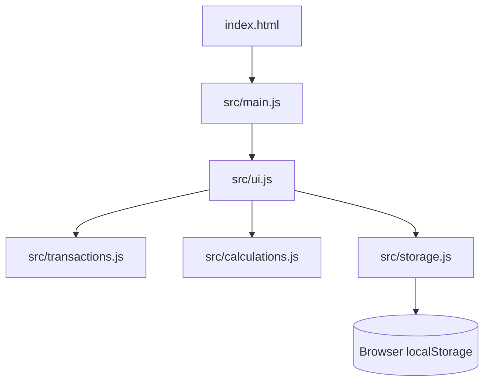

# Expense Tracker

A small, dependency-free expense tracker built with browser-native JavaScript modules. It lets you add, edit, delete, search, filter, and sort income and expense transactions, then persists them in `localStorage`.

## Features

- Add transactions with a description, amount, category, type, and date.
- Edit and delete existing transactions.
- Search by description and filter by category.
- Filter between all transactions, expenses, and income.
- Sort by amount from low to high or high to low.
- Display total income, total expenses, and balance.
- Display expense totals as category bars.
- Persist transactions in the browser under the `TRANSACTIONS` `localStorage` key.

## Technology Stack

- HTML5
- Vanilla JavaScript using ES modules
- Browser DOM APIs and `localStorage`
- No external dependencies, framework, build tool, or package manager configuration

## Project Structure

```text
expense-tracker/
├── index.html             # Page markup and form controls
├── src/
│   ├── main.js            # Application entry point and event wiring
│   ├── ui.js              # Rendering, filtering, sorting, and form actions
│   ├── transactions.js    # Transaction creation and date conversion
│   ├── calculations.js    # Income, expense, balance, and category totals
│   └── storage.js          # localStorage load and save helpers
├── LEARNED.md             # JavaScript concepts documented during development
└── plan.md                # Learning roadmap and project guidance
```

## Architecture



`main.js` loads saved data, creates the initial sample transactions when no saved data exists, and connects page events to the UI. `ui.js` reads the controls, updates the DOM, and calls the transaction, calculation, and storage helpers.

## Prerequisites

A modern web browser with support for JavaScript ES modules and `localStorage`. No project dependencies need to be installed.

## Running Locally

Because the application imports JavaScript modules, serve the repository over HTTP instead of opening the HTML file directly. From the `expense-tracker` directory, run:

```bash
python3 -m http.server 8000
```

Then open <http://localhost:8000> in a browser.

## Usage

1. Enter a description, amount, category, and date.
2. Leave the expense checkbox selected for an expense, or clear it for income.
3. Select **Add Transaction**.
4. Use the search, category, type, and sort controls to change the transaction list.
5. Select **Edit** or **Delete** beside a transaction to manage it.

Transactions are saved automatically after the list is rendered. Clearing the browser's site data removes the saved transactions and restores the sample data on the next load.

## Testing

No automated test files or test scripts are present in the repository. Manual verification can be performed by running the application in a browser and exercising the add, edit, delete, filtering, sorting, totals, chart, and persistence flows.

## Configuration and Deployment

The application has no environment variables, backend API, database, or deployment configuration. It can be deployed as static files to a host that serves `index.html` and the `src/` directory over HTTP.

## Future Improvements

Stage 13's asynchronouse programming and API calls

TypeScript/React

FastAPI

Backend Database

Docker Conatiners

## Contributing

Keep changes focused on the existing browser-based learning project. Update `LEARNED.md` when adding a JavaScript concept that has been encountered and understood, and update this README when the implemented application behavior changes.

## License

No license file or license metadata is present in the repository.

> TODO: Add a license if this project is intended for redistribution.
